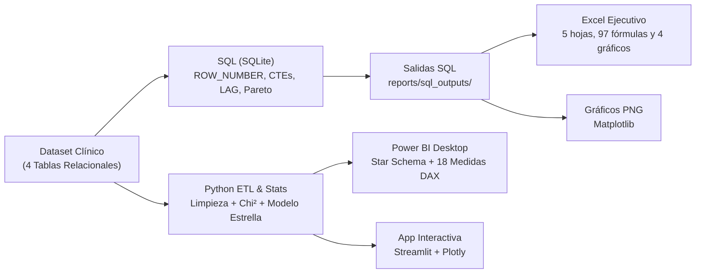
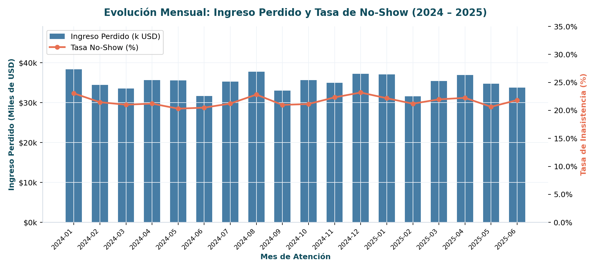
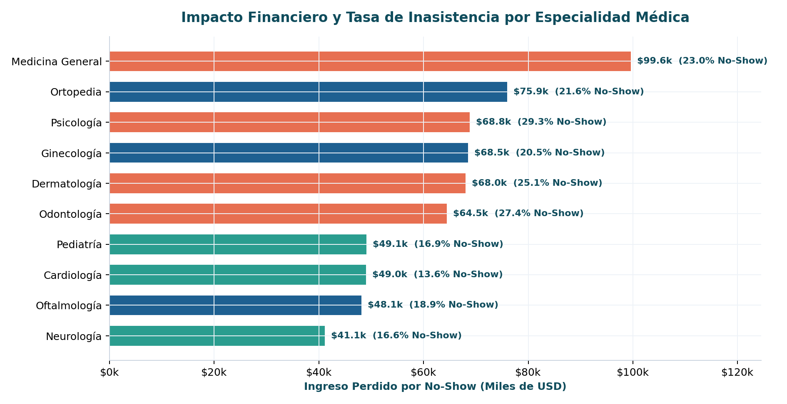
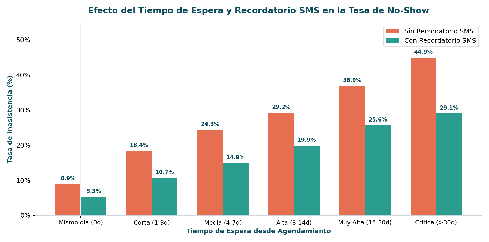
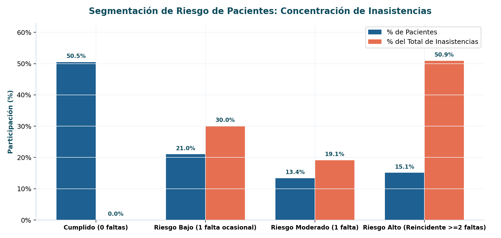

# Healthcare Appointments & No-Show Analytics (SQL + Python + Excel + Power BI)


Proyecto integral de **Análisis de Datos en el Sector Salud (Nivel Practicante / Junior Data Analyst)** sobre la operación de citas médicas ambulatorias de una red de **6 clínicas / IPS y 10 especialidades (2024–2025)**.  
El objetivo es cuantificar la pérdida financiera causada por la **inasistencia a citas médicas (No-Show)**, identificar sus factores determinantes, validar estadísticamente la efectividad de los recordatorios por SMS y segmentar pacientes de alto riesgo.

> **Nota sobre los datos:** Dataset clínico relacional sintético de 50,000 citas generado de forma reproducible (`seed=42`, [`src/generate_dataset.py`](src/generate_dataset.py)) modelado con patrones reales de operación ambulatoria en Colombia/LATAM, incluyendo duplicados y nulos controlados para demostrar limpieza ETL.

---

## Resumen Ejecutivo (KPIs Verificados)

| Métrica Operacional / Financiera | Resultado | Interpretación |
| :--- | :---: | :--- |
| **Citas Efectivas Analizadas** | **47,654** | Atendidas + No-Show (excluyendo 2,346 canceladas anticipadamente) |
| **Pacientes Únicos** | **14,714** | Atendidos en 6 sedes (Cali, Bogotá, Medellín y Barranquilla) |
| **Tasa de Asistencia** | **78.37%** | 37,348 consultas realizadas |
| **Tasa de Inasistencia (No-Show)** | **21.63%** | 10,306 cupos médicos perdidos |
| **Ingreso Realizado** | **$2,447,497 USD** | Facturación efectiva de consultas atendidas |
| **Ingreso Perdido por No-Show** | **$632,870 USD** | 20.5% del ingreso potencial perdido |
| **Reducción Relativa con SMS** | **-31.3%** | Validado con Chi-Cuadrado ($\chi^2 = 464.3$, $p < 0.001$) |
| **Recuperación Estimada (95% SMS)** | **$83,433 USD** | ~1,291 citas recuperables ampliando cobertura SMS |

---

## Arquitectura del Proyecto



### ¿Qué demuestra cada herramienta?

- **SQL (`sql/`)**: Deduplicación con `ROW_NUMBER()`, vistas clínicas limpias, `LAG()` para variación mensual de No-Show, Pareto de pérdidas financieras por especialidad (`SUM() OVER`) y segmentación de riesgo de pacientes.
- **Python (`src/`, `run_pipeline.py`, `app.py`)**: Generación reproducible, limpieza ETL, prueba de hipótesis **Chi-Cuadrado (`scipy.stats`)** para validar el efecto del SMS, simulación de recuperación financiera y dashboard en Streamlit.
- **Excel (`excel/Salud_Reporte_Ejecutivo.xlsx`)**: Libro ejecutivo con 5 hojas (*Resumen Ejecutivo*, *Tendencia Mensual*, *Especialidades*, *Factores No-Show*, *Riesgo Pacientes*), **97 fórmulas dinámicas** y 4 gráficos nativos.
- **Power BI (`powerbi/`)**: Modelo Estrella clínico (`fact_appointments`, `dim_patients`, `dim_doctors`, `dim_clinics`, `dim_date`), **18 medidas DAX**, tema visual médico (`healthcare_theme.json`) y guía paso a paso (`GUIA_POWER_BI.md`).

---

## Principales Hallazgos de Negocio

### 1. Estabilidad de la Pérdida Financiera Mensual
La inasistencia se mantiene estructuralmente entre **20.3% y 23.2% mensual**, generando una fuga recurrente de **$31k a $38k USD cada mes** sin medidas correctivas. Los lunes (**23.2%**), viernes (**23.1%**) y sábados (**24.1%**) concentran los picos semanales de inasistencia.



### 2. Impacto Financiero por Especialidad (Pareto)
Las **Top 6 especialidades** concentran el **70.4% de toda la pérdida financiera ($445k USD)**:
- **Mayor pérdida absoluta:** Medicina General ($99.6k), Ortopedia ($75.9k), Psicología ($68.8k), Ginecología ($68.5k) y Dermatología ($68.0k).
- **Mayor tasa de No-Show:** Psicología (**29.3%**), Odontología (**27.4%**) y Dermatología (**25.1%**), frente a especialidades de alta criticidad como Cardiología (**13.6%**) y Neurología (**16.6%**).



### 3. Tiempo de Espera y Efectividad Validada del Recordatorio SMS
El tiempo entre agendamiento y consulta multiplica por **4.1×** el riesgo de inasistencia (de **8.3%** el mismo día a **34.2%** en esperas >30 días), además de reducir la satisfacción de **4.37 ★** a **3.65 ★**.  
El envío de **recordatorios SMS** reduce la tasa global de No-Show de **27.03% a 18.57%** (**-8.46 pp / -31.3% relativo**, estadísticamente significativo con $p < 0.001$): en esperas críticas (>30 días), cae de **44.9% a 29.1%**.



### 4. Concentración del Riesgo en Pacientes Reincidentes
Solo el **15.1% de los pacientes** (2,223 pacientes con ≥2 inasistencias) generan el **50.9% del total de No-Shows** y **$317,300 USD en pérdidas**. Por perfil demográfico, el segmento de jóvenes **18–30 años** presenta la mayor inasistencia (**27.3%**), al igual que el régimen **Subsidiado (25.4%)** frente a **Particular (15.9%)**.



---

## Calidad de Datos (Limpieza ETL)

1. **Deduplicación:** Se identificaron y eliminaron **75 registros duplicados** mediante `ROW_NUMBER() OVER (PARTITION BY appointment_id)` en SQL y `drop_duplicates()` en Python.
2. **Imputación controlada:** Se normalizaron **180 registros nulos** en `booking_channel` bajo la categoría `'No Registrado'`.
3. **Regla de negocio clínica:** Se separaron las **2,346 citas canceladas anticipadamente** (cupo liberable) para calcular la tasa real de inasistencia estrictamente sobre citas efectivas (`Atendida` vs `No-Show`).

---

## Recomendaciones Accionables

1. **Automatizar recordatorios SMS / WhatsApp al 95% de citas futuras (>0 días):** Especialmente con confirmación 48h y 24h antes en esperas >7 días; potencial estimado de **+$83,433 USD** y **~1,291 consultas recuperadas**.
2. **Protocolo diferenciado para pacientes reincidentes (15.1% de la base):** Implementar confirmación obligatoria telefónica/WhatsApp y lista de espera inteligente (*overbooking* controlado) en **Psicología, Odontología y Dermatología** los lunes, viernes y sábados.
3. **Reducir ventana de espera en consulta externa:** Mantener tiempos de agendamiento menores a 7 días reduce el No-Show por debajo del 18% y sostiene la satisfacción clínica por encima de **4.35 ★**.

---

## Cómo Reproducir el Proyecto

```bash
# 1. Clonar repositorio e instalar dependencias
git clone https://github.com/JuanYanaya88/healthcare-appointments-analytics.git
cd healthcare-appointments-analytics
pip install -r requirements.txt

# 2. Ejecutar el pipeline completo (genera datos, SQLite, SQL, Modelo Estrella, Excel y gráficos)
python run_pipeline.py

# 3. Abrir el dashboard interactivo en Streamlit (opcional)
streamlit run app.py
```

---

## Autor

**Juan David Yanayaco Saenz** — Estudiante de Ingeniería en Ciencia de Datos / Practicante en Análisis de Datos  
GitHub: [@JuanYanaya88](https://github.com/JuanYanaya88)
