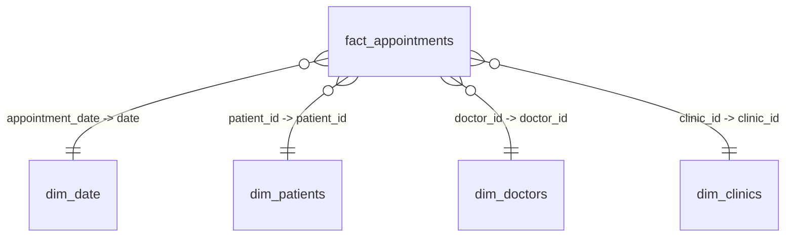

# Guía de Implementación en Power BI Desktop — Sector Salud

Esta guía permite construir el dashboard operacional de **Inasistencia a Citas Médicas (No-Show)** en Power BI Desktop usando el Modelo Estrella generado en `data/processed/`.

---

## 1. Modelo de Datos (Esquema Estrella Clínico)

| Tabla | Tipo | Llave | Descripción |
| :--- | :--- | :--- | :--- |
| `fact_appointments.csv` | Hechos | `appointment_id` | Citas efectivas, espera, SMS, estado, ingresos realizados/perdidos y satisfacción |
| `dim_patients.csv` | Dimensión | `patient_id` | Edad, grupo etario, régimen de aseguramiento, crónico y segmento de riesgo |
| `dim_doctors.csv` | Dimensión | `doctor_id` | Especialidad médica, sede principal y tarifa base |
| `dim_clinics.csv` | Dimensión | `clinic_id` | Sede, ciudad, nivel de complejidad y consultorios |
| `dim_date.csv` | Dimensión | `date` | Calendario para análisis temporal (marcar como tabla de fechas) |

---

## 2. Paso a Paso en Power BI Desktop

1. **Cargar datos:** `Obtener datos` → `Texto/CSV` e importa las 5 tablas desde `data/processed/`.
2. **Marcar tabla calendario:** selecciona `dim_date` → `Marcar como tabla de fechas` (`date`).
3. **Configurar relaciones (`1:*`):** une `dim_date`, `dim_patients`, `dim_doctors` y `dim_clinics` hacia `fact_appointments`.
4. **Aplicar tema clínico:** `Ver` → `Temas` → `Explorar temas` → selecciona `powerbi/healthcare_theme.json`.
5. **Agregar medidas DAX:** crea una tabla `_Medidas` y copia las 18 fórmulas de `powerbi/medidas_dax.dax`.

---

## 3. Estructura Recomendada (3 Páginas)

### Página 1 — Resumen Operacional y Financiero
- **Tarjetas KPI:** `Total Citas Efectivas`, `Tasa de No-Show %`, `Ingreso Perdido (USD)`, `Espera Promedio (Días)`, `Satisfacción Promedio`.
- **Gráfico combinado:** `Ingreso Perdido (USD)` (barras) + `Tasa de No-Show %` (línea) por `dim_date[year_month]`.
- **Barras horizontales:** Especialidades ordenadas por `Ingreso Perdido (USD)`.

### Página 2 — Factores de Inasistencia (Espera y SMS)
- **Barras agrupadas:** `Tasa de No-Show %` por `lead_time_bucket`, leyenda = `sms_reminder_sent`.
- **Tarjetas de impacto:** `Tasa No-Show sin SMS`, `Tasa No-Show con SMS`, `Reducción No-Show por SMS (pp)`.
- **Matriz:** Régimen de aseguramiento y canal de agendamiento vs `Tasa de No-Show %`.

### Página 3 — Riesgo de Pacientes y Sedes
- **Barras agrupadas:** `% Pacientes` vs `Ingreso Perdido (USD)` por `dim_patients[risk_segment]`.
- **Tabla por sede:** Ciudad, Complejidad, `Tasa de No-Show %`, `Ingreso Perdido (USD)` y `Satisfacción Promedio`.
